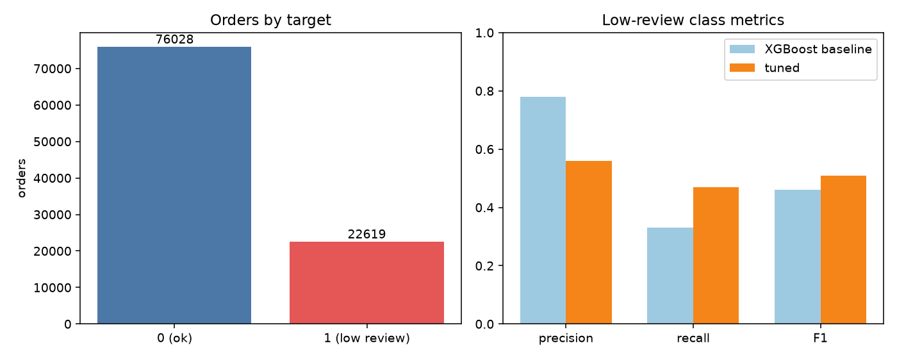

# Olist E-commerce: Low Review Risk

Predict which orders are likely to get a bad review (score 1–3) so a support team could contact the customer before or after delivery.

This is a portfolio project on the public Olist Brazilian e-commerce dataset. The dataset is messy and has strong class imbalance, so most of the work is in the data pipeline and in choosing a threshold that makes sense for the business.

## Dataset and task

- Source: Olist Brazilian E-Commerce Public Dataset (Kaggle).
- 9 relational tables are joined into one order-level table.
- Target: `is_negative_review` = 1 if the review score is 1, 2 or 3.
- Final table: 98,647 orders and 44 features.

The processed Parquet file is included, so training can be run without rebuilding the SQL part.

## Results

| Model | ROC-AUC | PR-AUC | Precision (class 1) | Recall (class 1) | F1 |
|---|---:|---:|---:|---:|---:|
| Random Forest baseline | 0.733 | 0.554 | 0.64 | 0.40 | 0.49 |
| XGBoost baseline | 0.744 | 0.581 | 0.78 | 0.33 | 0.46 |
| XGBoost + Optuna + threshold tuning | — | — | 0.56 | 0.47 | 0.51 |

The tuned model finds about half of the low-review orders. Precision drops, but the point was to catch more problem orders instead of flagging only the safest ones.



## What is in the repo

```
data/processed/olist_processed.parquet   ready order-level dataset
sql/build_olist_ml_dataset.sql           joins 9 tables into one order view
src/build_dataset.py                     builds the dataset from the raw CSVs
src/preprocessor.py                      sklearn preprocessing
src/train_baseline.py                    Random Forest baseline
src/train_xgboost.py                     XGBoost + Optuna + threshold tuning
reports/result.md                        short experiment log
reports/metrics.png                      class balance and model metrics
```

## How to run

```bash
pip install -r requirements.txt
python src/train_baseline.py
python src/train_xgboost.py
```

Both scripts read `data/processed/olist_processed.parquet`. The raw CSVs are not included because of size; `src/build_dataset.py` and the SQL file show how the table was built.

## Notes and limitations

- Several strong features are delivery related (delivery time, delay, etc.). So the model is more a post-delivery risk model than a perfect pre-purchase predictor.
- The threshold was tuned for recall. In a real support process it should be chosen together with the cost of contacting a customer.
- The dataset is from 2016–2018 and is used for practice, not for real business decisions.
